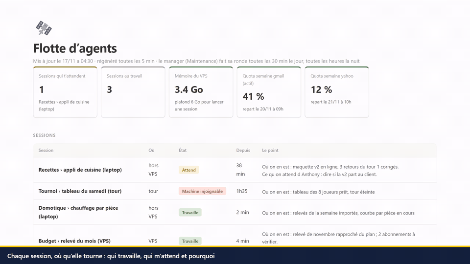

[English](README.md) · **Français**

# Flotte d'agents

**Une page montre toutes les sessions d'agents de programmation que je fais tourner, sur toutes mes machines : qui travaille, qui m'attend, et pourquoi.**

*La vraie page, remplie de données de démonstration. [Vidéo complète (1:04)](https://drive.google.com/file/d/1Y2USQyYhHUVtt-65RvrHAnOG4QcVHc_g/view)*

## Ce qu'on en fait

- **Sessions.** Chaque session du serveur, du portable, de la tour et des postes partagés, avec son état (travaille, attend, en pause, machine injoignable) et un point court sur où elle en est.
- **Aiguillage.** Une demande va à la session ouverte qu'elle concerne, ou en ouvre une avec un modèle et un effort choisis selon la difficulté.
- **Décisions communes.** Une règle qui vaut partout est diffusée une fois, puis injectée dans chaque session, sur chaque machine.
- **Annonces vérifiées.** Chaque message qui annonce un résultat est revérifié aussitôt par un agent neuf en lecture seule ; s'il le conteste, la session corrige une fois.
- **Bilan de la semaine.** Chaque lundi à 8 h, par session.
- **Ménage.** Les sessions du serveur dont le lien de pilotage à distance est coupé depuis une heure sont fermées.

## Architecture

Diagramme en français

## État

- **En service** depuis le 29/10/2026 ; la page est sur mon serveur, joignable seulement par Tailscale.
- **Bilan du 16/11/2026 :** autonomie 58 %, 135 relances, 115 rétractations, 377 annonces contestées, 46 renvois.
- **Limite connue :** l'évaluation ne lit que les conversations tenues sur le serveur.
- **Technique.** Python et cron (page, aiguillage, résumés, bilan), TypeScript (extensions de Claude Code), tmux, Tailscale.

---

**Anthony Hunt** · [ingevision.cloud](https://ingevision.cloud/?p=pilotage-flotte) · [LinkedIn](https://www.linkedin.com/in/anthony-hunt-3948a9196) · [GitHub](https://github.com/anthohunt)

Le code et les données sont privés : ils décrivent mes sessions et les machines qui les portent.
