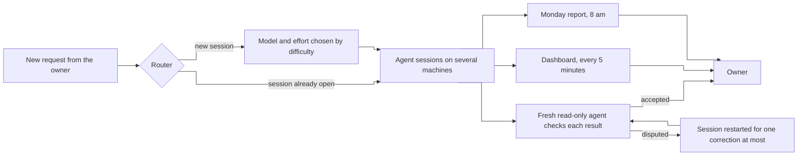
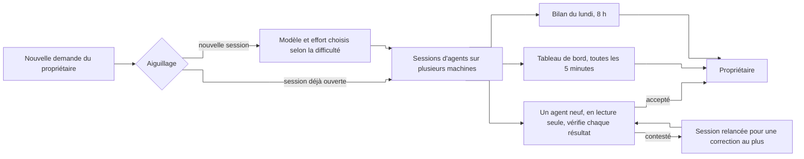

# Agent fleet dashboard

A coordination post that tracks, across several machines, the coding-agent sessions at work, what they are waiting for and the state of the machines that run them.

**English** · [Français](#version-française)

> Showcase repository: the code and data of this project are private; this README describes it.

## The problem

Anthony runs several agent sessions in parallel on a server, a laptop and shared compute workstations. Without tracking, he had to chase each agent, restart the ones that had stopped and receive results announced too early or wrong. Fleet management centralises this supervision: a dashboard tells him who is working, who is waiting for him, and why.

## What it does

- **The dashboard is regenerated every 5 minutes**: sessions and their state (working, waiting, paused), status of each project, compute workstations and their reservations, quota, shared decisions, coordination log.
- **A summary of each session** is written every 30 minutes.
- **Requests go through a router**: it points to the open session concerned, or opens one with a model and an effort level chosen by difficulty (simple, medium, hard).
- **A decision that applies to every session** is published once, then injected into each session, on each machine.
- **Results are checked before they reach the owner**: a fresh read-only agent checks each one; if it disputes the result, the session is restarted for one correction at most.
- **Every Monday at 8 am, a weekly report** measures session autonomy, restarts, retractions, disputed results and hand-backs to the owner.

The round of the sessions themselves (restarts, closing, delegation table) is the job of [Agent - Session manager](https://github.com/anthohunt/agent-session-manager).

## What is built

In service since 29 October 2026. Functions in place:

- Dashboard, summaries, routing, shared decisions, verification before reporting and weekly report.
- Automatic closing, after one hour, of sessions whose remote-control link is cut (checked every 10 minutes).
- Network watchdog on 3 compute workstations: it checks the link every 5 minutes and repairs it on its own. During test outages, it restored each workstation in 3 min 26 s to 4 min 24 s.

| Report of 2 November 2026 | |
|---|---|
| Overall autonomy | 47 % |
| Restarts | 114 |
| Retractions | 18 |
| Results disputed by the verifier | 64 |
| Hand-backs to the owner | 17 |

Known limit: the evaluation only reads conversations held on the server.

## What it runs on

The dashboard, its code and its data stay private: they describe an institution's machines. There is nothing to install from this repository.

- Python (dashboard, routing, summaries, report)
- TypeScript (agent tool extensions: shared decisions, verification)
- cron, tmux
- Tailscale
- Windows batch scripts and scheduled tasks (network watchdog)
- HTML and CSS

## Its page

- English: <https://ingevision.cloud/?lang=en&p=pilotage-flotte>
- Français : <https://ingevision.cloud/?p=pilotage-flotte>

---

## Version française

# Pilotage de la flotte d'agents

Un poste de coordination qui suit, sur plusieurs machines, les sessions d'agents de programmation au travail, ce qu'elles attendent et l'état des machines qui les portent.

> Dépôt vitrine : le code et les données de ce projet sont privés ; ce README le décrit.

### Le problème

Anthony fait tourner en parallèle plusieurs sessions d'agents sur un serveur, un portable et des postes de calcul partagés. Sans suivi, il devait courir après chaque agent, relancer ceux qui s'étaient arrêtés et recevoir des résultats annoncés trop tôt ou faux. Le pilotage centralise cette supervision : un tableau de bord dit qui travaille, qui l'attend, et pourquoi.

### Ce qu'il fait

- **Le tableau de bord se régénère toutes les 5 minutes** : sessions et leur état (travaille, attend, en pause), point de chaque projet, postes de calcul et leurs réservations, quota, décisions communes, journal de la coordination.
- **Un résumé de chaque session** est écrit toutes les 30 minutes.
- **Les demandes passent par un aiguillage** : il désigne la session ouverte concernée, ou en ouvre une avec un modèle et un niveau d'effort choisis selon la difficulté (simple, moyenne, difficile).
- **Une décision qui vaut pour toutes les sessions** est diffusée une fois, puis injectée dans chaque session, sur chaque machine.
- **Les résultats sont vérifiés avant de remonter** : un agent neuf, en lecture seule, vérifie chacun ; s'il le conteste, la session est relancée pour une correction au plus.
- **Chaque lundi à 8 h, un bilan de la semaine** mesure l'autonomie des sessions, les relances, les rétractations, les résultats contestés et les renvois vers le propriétaire.

Le tour des sessions elles-mêmes (relances, fermetures, tableau de délégation) revient à l'[Agent - Manager des sessions](https://github.com/anthohunt/agent-session-manager).

### Ce qui est construit

En service depuis le 29/10/2026. Fonctions en place :

- Tableau de bord, résumés, aiguillage, décisions communes, vérification avant remontée et bilan hebdomadaire.
- Fermeture automatique, après une heure, des sessions dont le lien de pilotage à distance est coupé (contrôle toutes les 10 minutes).
- Surveillant réseau sur 3 postes de calcul : il vérifie le lien toutes les 5 minutes et le répare seul. Lors des coupures de test, il a rétabli chaque poste en 3 min 26 s à 4 min 24 s.

| Bilan du 02/11/2026 | |
|---|---|
| Autonomie globale | 47 % |
| Relances | 114 |
| Rétractations | 18 |
| Résultats contestés par le vérificateur | 64 |
| Renvois vers le propriétaire | 17 |

Limite connue : l'évaluation ne lit que les conversations du serveur.

### Où il tourne

Le tableau de bord, son code et ses données restent privés : ils décrivent le parc d'un établissement. Il n'y a rien à installer depuis ce dépôt.

- Python (tableau de bord, aiguillage, résumés, bilan)
- TypeScript (extensions de l'outil d'agents : décisions communes, vérification)
- cron, tmux
- Tailscale
- Scripts batch Windows et tâches planifiées (surveillant réseau)
- HTML et CSS

### Sa fiche

- Français : <https://ingevision.cloud/?p=pilotage-flotte>
- English: <https://ingevision.cloud/?lang=en&p=pilotage-flotte>

---

**Anthony Hunt** · [Project page on ingevision.cloud](https://ingevision.cloud/?lang=en&p=pilotage-flotte) · [LinkedIn](https://www.linkedin.com/in/anthony-hunt-3948a9196) · [GitHub profile](https://github.com/anthohunt) · anthony@ingevision.cloud
