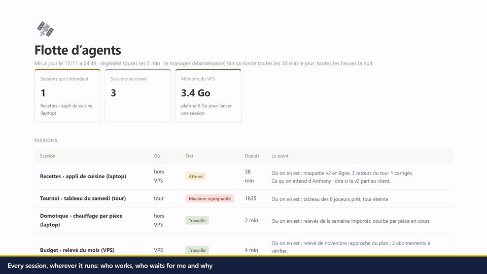
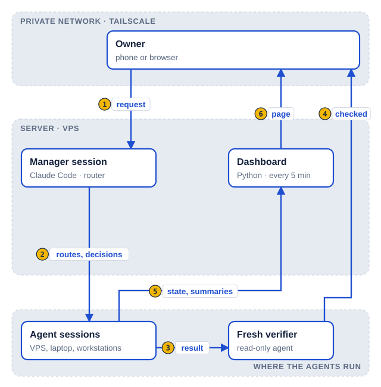

**English** · [Français](README.fr.md)

# Agent fleet

**One page shows every coding-agent session I run, on every machine: who is working, who is waiting for me, and why.**

*The real page, filled with demo data. [Full video (1:04)](https://drive.google.com/file/d/1mxuK-VwTylMy7krMUYF3kyMyePExenUA/view)*

## Using it

- **Sessions.** Every session on the server, the laptop, the gaming PC and the shared workstations, with its state (working, waiting, paused, machine unreachable) and a short summary of where it stands.
- **Routing.** A request goes to the open session it concerns, or opens a new one with a model and effort chosen by difficulty.
- **Shared decisions.** A rule that applies everywhere is published once and injected into every session, on every machine.
- **Checked claims.** Each message that announces a result is checked right after by a fresh read-only agent; if it disputes it, the session corrects once.
- **Weekly report.** Every Monday at 8 am, per session.
- **Housekeeping.** Server sessions whose remote-control link has been cut for an hour are closed.

## Architecture

French version

## Status

- **In service** since 29 October 2026; the page is on my server, reachable only over Tailscale.
- **Report of 16 November 2026:** autonomy 58 %, 135 nudges, 115 retractions, 377 disputed claims, 46 hand-backs.
- **Known limit:** the evaluation only reads the conversations held on the server.
- **Stack.** Python and cron (page, routing, summaries, report), TypeScript (Claude Code extensions), tmux, Tailscale. Interface in French.

---

**Anthony Hunt** · [ingevision.cloud](https://ingevision.cloud/?lang=en&p=pilotage-flotte) · [LinkedIn](https://www.linkedin.com/in/anthony-hunt-3948a9196) · [GitHub](https://github.com/anthohunt)

The code and the data are private: they describe my sessions and the machines they run on.
